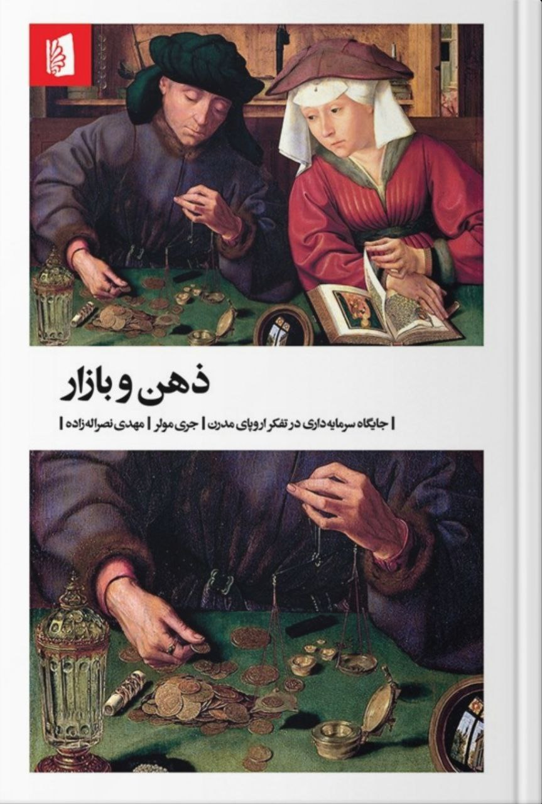

نام: ذهن و بازار

نویسنده: جری مولر

مترجم: مهدی نصر‌اله زاده

موضوع: اقتصاد، فلسفه‌سیاسی، تاریخ‌فلسفه

موضوع:  جری مولر در هر فصل کتاب به شرح دیدگاه‌های یک فیلسوف در‌باب بازار آزاد می‌پردازد. نویسنده به بررسی دیدگاه‌های مدافعان و مخالفان بازار می‌پردازد.

نظر شخصی: به‌شخصه این کتاب رو یک اثر خیلی خوب در باب اقتصاد سیاسی می‌دونم و هر کسی که واقعا قصد داره راجع به اقتصاد یا فلسفه سیاسی بدونه به‌نظرم باید این کتاب رو بخونه. مطمئنم کسی که دنبال عمق دادن به دانش خودش از اقتصاد و فلسفه سیاسی باشه از خوندن این کتاب به‌هیچ‌عنوان‌ ضرر نمی‌کنه.

[\#معرفی\_کتاب](</?tag=معرفی کتاب>)

[@said\_to\_who\_reads](<https://t.me/said_to_who_reads>)
