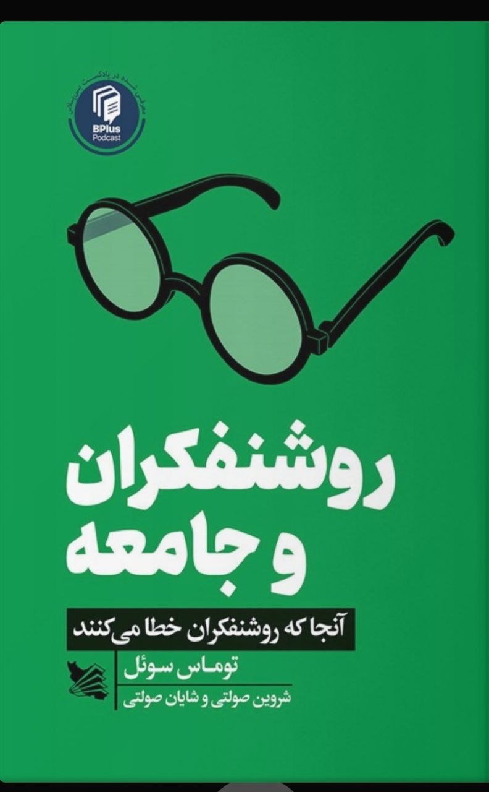

نام: روشنفکران و جامعه

نویسنده: توماس سوئل

مترجم: شروین و شایان صولتی

موضوع: این کتاب نقدی است جامع بر روشنفکران و اندیشه‌ها و ادعا‌های آن‌ها در موضوعات اقتصاد، جامعه‌شناسی و سایر موضوعات مورد علاقه این قشر. توماس ساموئل در این‌کتاب با دو ابزار استدلال و شواهد تاریخی و ارقام و آمار به جنگ روشنفکران می‌رود و با دیدگاه‌های آن‌ها مخالفت می‌کند.

نظر شخصی: به‌شخصه این کتاب را اثری تلقی می‌کنم که نیازمند پاسخی در خور از یک عضو قشر روشنفکر است. زیرا زبان این کتاب نه زبان آثار مارکس پر از اصطلاحات تخصصی و چه‌بسا تازه‌تولید شده برای اولین بار! بلکه زبان عامه است و عام را تماشاگران نبرد خود با دیدگاه‌های روشنفکران قرار داده است. در صورتی که دوست دارید نقدی قابل تحسین و عین حال روشن و جذاب از بینش‌های قشر روشنفکر ببینید، این‌کتاب را جز گزینه‌های خود قرار بدهید.

[\#معرفی\_کتاب](</?tag=معرفی کتاب>)\
[@said\_to\_who\_reads](<https://t.me/said_to_who_reads>)
