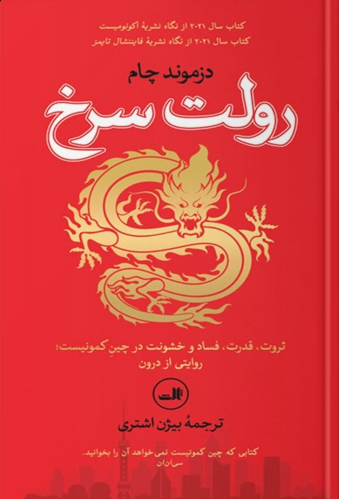

نام: رولت سرخ

نویسنده: دزموند چام

مترجم: بیژن اشتری

موضوع: چین در دوران حاکمیت حزب کمونیست

نظر شخصی: این کتاب به خوبی راه ثروتمند شدن در چین و موانع موجود در این راه را توصیف می‌کند. نویسنده که خود تجربه تلاش برای ثروتمند شدن در چین را داشته است. توصیف می‌کند که شما در چین برای پیش بردن طرح‌های اقتصادی چقدر وابسته به کارمندان رژیم (علی الخصوص افراد متصل به حزب) هستید.

[\#معرفی\_کتاب](</?tag=معرفی کتاب>)\
[@said\_to\_who\_reads](<https://t.me/said_to_who_reads>)
