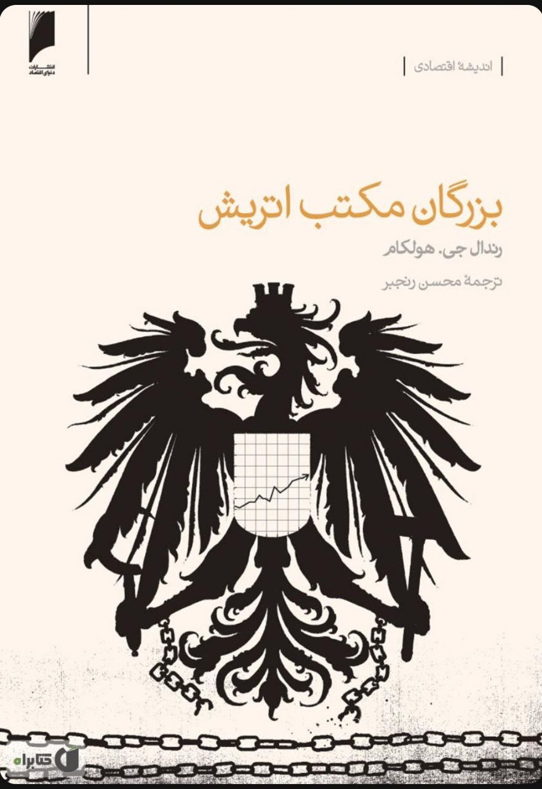

نام: بزرگان متکب اتریش

نویسنده: رندال جی. هولکام

مترجم: محسن رنجبر

موضوع: این کتاب به شرح دیدگاه و آثار بزرگترین متفکرین مکتب اقتصادی اتریش می‌پردازد. این کتاب شامل چند مقاله است که هر کدام به یک متفکر اختصاص دارد. نویسنده هر مقاله با مقاله‌های دیگر متفاوت است.

نظر شخصی: مطالعه این کتاب به من نشان داد که بر خلاف تصور اشتباهی که داشتم، مکتب اقتصادی اتریش مکتبی جدید و متولد اواخر قرن نوزدهم نیست. بلکه ریشه‌هایی عمیق‌تر دارد.

تاریخچه این مکتب به قرون وسطا و  فیلسوفان مدرسی بر می‌گردد! نکته بسیار مهم دیگری که من بعد از مطالعه این کتاب به‌آن پی بردم این بود که در دوران رنسانس حاکمیت مکتب فایده‌گرایی بر حوزه علوم انسانی موجب شد تا اقتصاد در قیاس با سایر علوم از پیشرفت باز بماند و به‌قول معروف اقتصاد علمی بود که در دوران رنسانس در‌جا زد.

مطالعه این کتاب را به کسانی توصیه می‌کنم که تمایل به آشنایی بیشتری با متفکرین تاثیرگذار مکتب اقتصادی اتریش دارند.

[\#معرفی\_کتاب](</?tag=معرفی کتاب>)\
[@said\_to\_who\_reads](<https://t.me/said_to_who_reads>)
