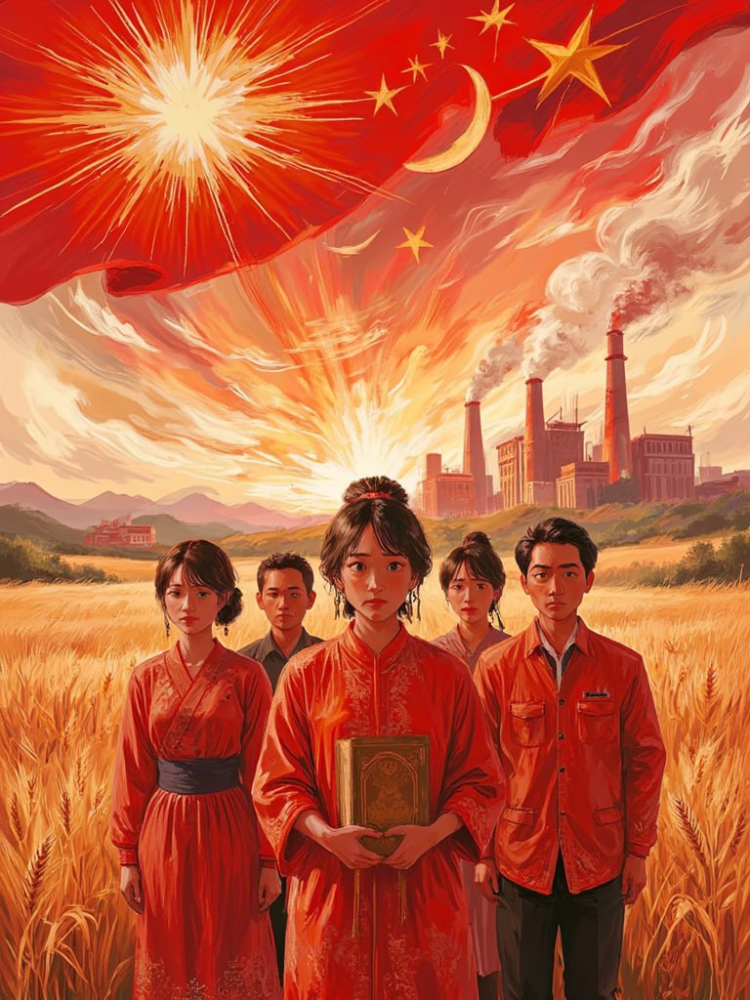

برخلاف انگلستان، هلند و اسپانیا که در زمان استعمارگری خود، مستعمره‌های خود را تا حد امکان غارت می‌کردند و مردم مناطق مستعمره نشین خود را تا حد حیوان پایین می‌آوردند، شوروی به مستعمرات خود نه تنها پول و منابع معدنی زیاد می‌داد، بلکه محصولات تولیدی آن‌ها را نیز می‌خرید!

فکر نمی‌کنم نیازی به ذکر این مطلب باشد که شوروی می‌توانست با قیمتی بسیار به‌صرفه‌تر محصولاتی که از مستعمرات خود وارد می‌کرد را از غرب وارد کند! به حق که شوروی مهربان‌ترین استعمارگر تاریخ است.

[\#خود\_گفته](</?tag=خود گفته>)\
[\#اقتصاد\_سیاسی](</?tag=اقتصاد سیاسی>)\
[@said\_to\_who\_reads](<https://t.me/said_to_who_reads>)
