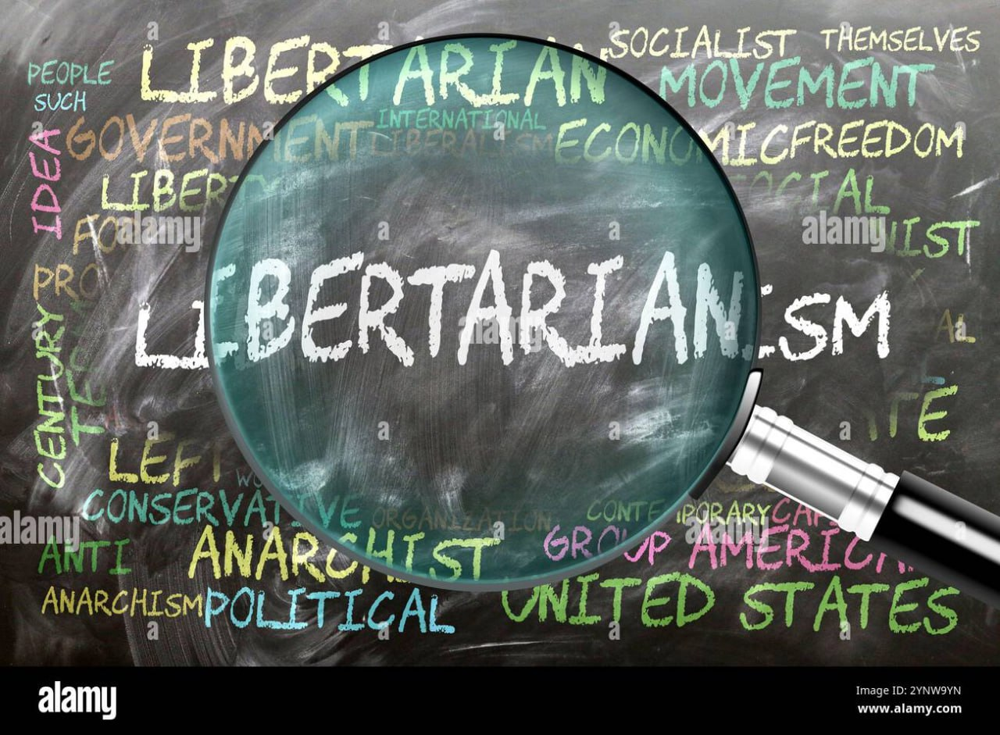

به‌شخصه فکر می‌کنم یکی از دلایلی که لیبرتاریانیسم در دنیای سیاست فلسفه‌ای تا این حد مطرود است، این است که برای سیاست‌مداران زیادی اخلاقی است!

فلسفه‌ای که مداخله در امور سایر کشور‌ها را نفی می‌کند و حتی تحریم اقتصادی سایر کشور‌ها را نیز مشروع نمی‌شمارد، برای کشور‌هایی که تمایلات شدید استعمارگرایانه دارند، مانند چین یا ایالات متحده آمریکا بیشتر شبیه یک جوک است!

[\#اقتصاد\_سیاسی](</?tag=اقتصاد سیاسی>)\
[@said\_to\_who\_reads](<https://t.me/said_to_who_reads>)
