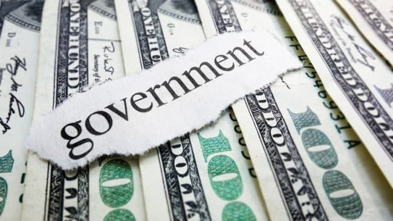

"کمک‌های مالی دولت به برخی صنایع می‌تواند فرایند پیشرفت صنعتی و اقتصادی کشور را تسریع کند. از این رو، ایرادی ندارد که دولت در شرایطی که صنایع تحت فشار مالی هستند یا در شرف ورشکستگی، به آن‌ها کمک مالی بکند."

نکته بسیار مهمی که این عزیزان در استدلال خود لحاظ نمی‌کنند این است که این استدلال می‌تواند هر مداخله‌ای از طرف دولت را در اقتصاد توجیه کند.

و اگر دست دولت را برای مداخله در اقتصاد تا این حد باز بگذاریم، نمی‌دانیم که آیا خواهیم توانست این دست‌ها را از اقتصاد دوباره کوتاه کنیم؟

[\#اقتصاد\_سیاسی](</?tag=اقتصاد سیاسی>)\
[\#خود\_گفته](</?tag=خود گفته>)\
[@said\_to\_who\_reads](<https://t.me/said_to_who_reads>)
