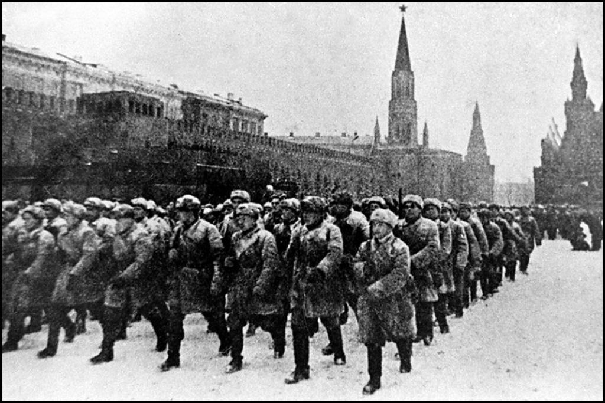

این‌که ملتی داوطلبانه برای حفظ غرور ملی به میدان جنگ می‌رود و در راه دفاع از خاک خود هزاران کشته می‌دهد، عمل قهرمانی و قابل احترام است.

اما حکومتی که ملت را قربانی حفظ غرور خود در برابر حکومت‌های دیگر می‌کند، نهادی کثیف است که تشکیل شده از افرادی بی‌وجدان و دارای خودشیفتگی شدید است که قربانی کردن ملت خود را برای حفظ رژیم نکبت‌بار خود جایز می‌دانند.

عکس: رژه سربازان ارتش سرخ در مسکو در سال ۱۹۴۱ چند روز قبل از شروع نبرد مسکو.

[\#خود\_گفته](</?tag=خود گفته>)\
[\#اقتصاد\_سیاسی](</?tag=اقتصاد سیاسی>)\
[@said\_to\_who\_reads](<https://t.me/said_to_who_reads>)
