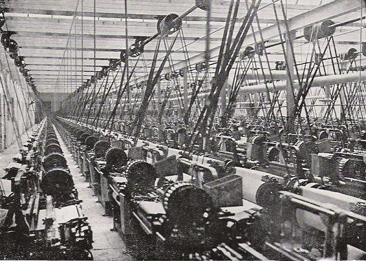

در قرن ۱۹ ام حکومت عثمانی تصمیم گرفت دست به صنعتی‌سازی دولتی بزند. در این راستا اولین کارخانه نساجی در عثمانی ساخته شد.

اولین مشکلی که دولت عثمانی بعد از ساخته شدن این کارخانه با آن مواجه شد این بود که تولیدات آن را کسی نمی‌خرید.

دلیل این موضوع بسیار ساده بود: تولیدات این کارخانه توان رقابت با محصولات نساجی انگلیسی را نداشت.

و اما راهکار دولت؟ گذاشتن تعرفه سنگین گمرکی بر محصولات نساجی خارجی و معاف کردن مواد اولیه کارخانه از مالیات و هر نوع تعرفه!

در واقع شهروندان عثمانی برای صنعتی‌سازی‌ای که هدفش معلوم نبود باید برای کالای بی‌کیفیت‌تر پول بیشتری خرج می‌کردند.

نکته جالب‌تر این است که عثمانی این راهکار را خود ابداع نکرده بود. بلکه این راهکار را از انگلیسی‌ها اقتباس کرده بود!

نمی‌دانم من بسیار از دنیا عقبم یا این‌که ترکیه امروز هیچ برتری‌ محسوسی در حوزه نساجی ندارد؟

[\#تاریخ](</?tag=تاریخ>)\
[\#اقتصاد\_سیاسی](</?tag=اقتصاد سیاسی>)\
[@said\_to\_who\_reads](<https://t.me/said_to_who_reads>)
