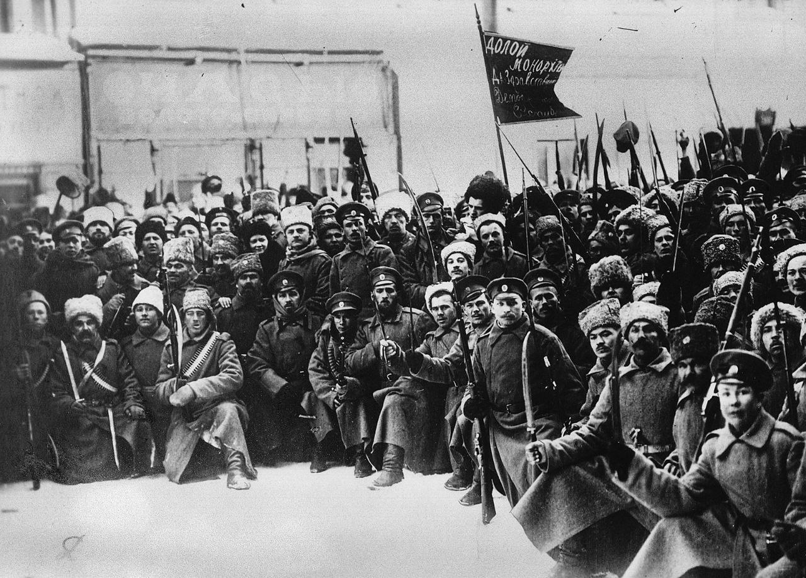

یکی از مهم‌ترین سیاست‌ها در راستای پایدارسازی یک رژیم، اطمینان حاصل کردن از این است که نیروهای مسلح دست به کودتا نزنند.

از نظر تاریخی کمونیست‌ها ((به‌طور دقیق‌تر بلشویک‌ها)) اولین کسانی بودند که اهمیت این موضوع را درک کردند.

در سال ۱۹۲۳ بعد از نابودی کامل نیروهای سفید ((بازمانده‌های نیروهای ارتش روسیه در زمان حاکمیت تزار‌های خاندان رومانف)) ارتش سرخ تبدیل به تنها نیروی مسلح موثر در شوروی تبدیل شد.

هرچند که صرف تاسیس این نهاد توسط تروتسکی ((یکی از اعضای بلندپایه حزب بلشویک)) به بلشویک‌ها اطمینان نداد.

آن‌ها ارتش را پر از کمیسر‌های سیاسی حزب کمونیست کردند. و تمام سمت‌های فرماندهی ارتش سرخ به دست اعضای بلند‌پایه حزب کمونیست رسید.

در واقع حزب کمونیست از طریق کمیسر‌های سیاسی، از نفوذ خود در درجه‌های پایین ارتش اطمینان حاصل می‌کرد.

همچنین با گماردن اعضای بلندپایه حزب کمونیست به‌عنوان فرماندهان ارتش، حزب کمونیست در مناصب بلندپایه نیز نفوذ کامل برای خود ایجاد کرد.

این الگو در انقلاب چین در دهه ۱۹۵۰، ویتنام در همین دهه، یوگسلاوی و کوبا تکرار شد.

[\#تاریخ](</?tag=تاریخ>)\
[\#فلسفه\_سیاسی](</?tag=فلسفه سیاسی>)\
[@said\_to\_who\_reads](<https://t.me/said_to_who_reads>)
