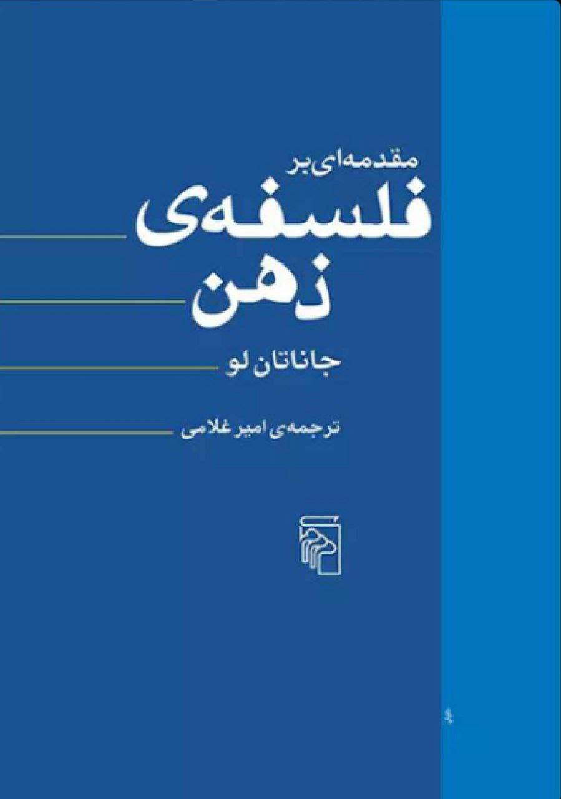

نویسنده: جاناتان لو

مترجم: امیر غلامی

موضوع: این کتاب به بررسی و معرفی مباحث موجود در فلسفه ذهن می‌پردازد. به این شکل که در هر فصل‌ سوالات کلیدی‌ای مرتبط با فلسفه ذهن مطرح شده، دیدگاه‌ها و پاسخ‌های متفاوتی که به آن داده شده است بررسی می‌شود.

نویسنده گاها نظر خود را نیز در مورد پاسخ‌های موجود می‌گوید.

نظر شخصی: کتابی بسیار مناسب و انگیزه بخش برای افرادی که به دنبال مطالعه در حوزه فلسفه ذهن هستند می‌باشد.

اگر می‌خواهید برای اولین بار نیز مطالعه فلسفه ذهن را شروع کنید، این کتاب می‌تواند گزینه مطلوبی برای شما باشد.

[\#معرفی\_کتاب](</?tag=معرفی کتاب>)\
[\#فلسفه](</?tag=فلسفه>)\
[@said\_to\_who\_reads](<https://t.me/said_to_who_reads>)
