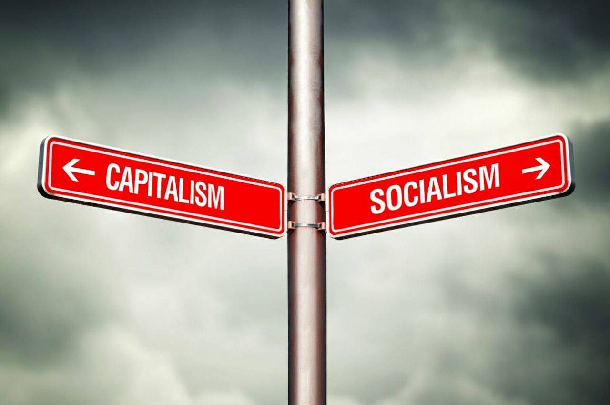

برای گذار از بازار آزاد به سوسیالیسم تنها نیاز به حکومتی با منش سوسیالیستی و دستگاه سرکوب سازمان‌یافته و قدرتمند است.

زیرا نابودی بازار آزاد چیزی نیست جز سلب حق مالکیت خصوصی میلیون‌ها فرد که ارتباط‌شان با یکدیگر محدود به مبادله و تجارت است.

اما گذار از سوسیالیسم به بازار آزاد مستلزم جنگی طولانی و فرسایشی با سازمانی عظیم دارای لشگری متشکل از میلیون‌ها کارمند است که ارتباط و همبستگی عمیقی با یکدیگر دارند زیرا به خوبی می‌دانند که چه منافع مشترک عظیمی با یکدیگر دارند.

به همین دلیل است که کشوری مانند کوبا در زمان کاسترو در کمتر از ۵ سال موفق به نابودی بازار و گذار به سوسیالیسم شد.

به دلیل مشابه نیز تلاش‌های گورباچف برای گذار از سوسیالیسم به بازار آزاد در طول ۶ سال منجر به سرنگونی خودش و نابودی اتحاد جماهیر شوروی شد!

[\#تاریخ](</?tag=تاریخ>)\
[\#فلسفه\_سیاسی](</?tag=فلسفه سیاسی>)\
[@said\_to\_who\_reads](<https://t.me/said_to_who_reads>)
