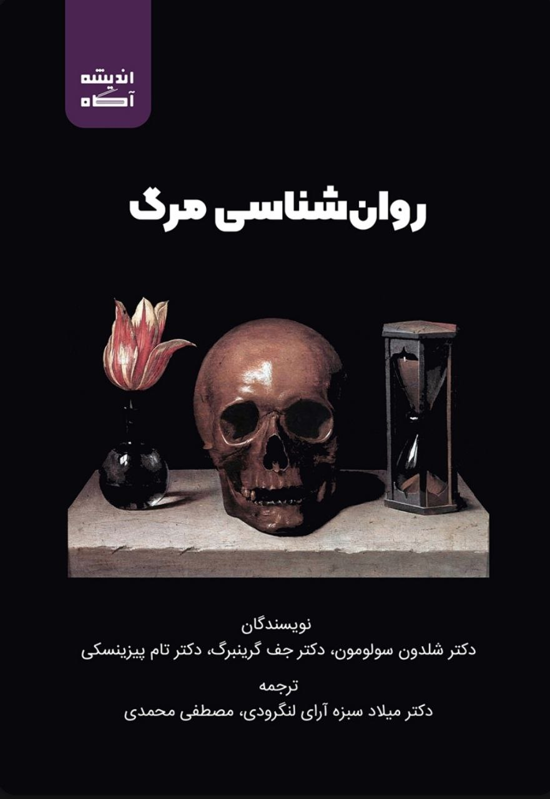

نويسندگان: شلدون سولومون، جف گزینبرگ، تام پیزینسکی

مترجمان: میلاد سبزه‌آرای لنگرودی، مصطفی محمدی

موضوع: نویسندگان در این کتاب به تحلیل تاثیرات حاصل از یادآوری مرگ و آگاهی انسان از اجتناب‌ناپذیری آن بر روی افکار و اعمال وی در طول تاریخ بشر می‌پردازند.

نظر شخصی: این کتاب برای من تاثیرگذاری بسیار خاصی داشت. آن را حدود ۲ یا ۳ سال پیش مطالعه کرده بودم و در این ایام به این فکر افتادم که دوباره آن را بخوانم.

علیرغم این که برای بار دوم این کتاب را می‌خوانم، مطالب آن همچنان برای من میخکوب کننده است! بسیاری از ارتباطاتی را که نویسندگان راجع به مرگ و تاثیر آن بر افکار انسان را بیان کرده‌اند به شخصه تجربه کرده بودم!

این کتاب دید من را نسبت به روان انسان بشدت تحت تاثیر قرار داد. گمان می‌کنم بد نیست که بازنگری‌ای در جهان‌بینی خود داشته باشم.

تنها نکته منفی این کتاب آن است که مترجمان دیدی منفی به تکامل دارند و این موضوع ممکن است خود را به نحوی در فرایند ترجمه نشان داده باشد...

[\#معرفی\_کتاب](</?tag=معرفی کتاب>)\
[@said\_to\_who\_reads](<https://t.me/said_to_who_reads>)
