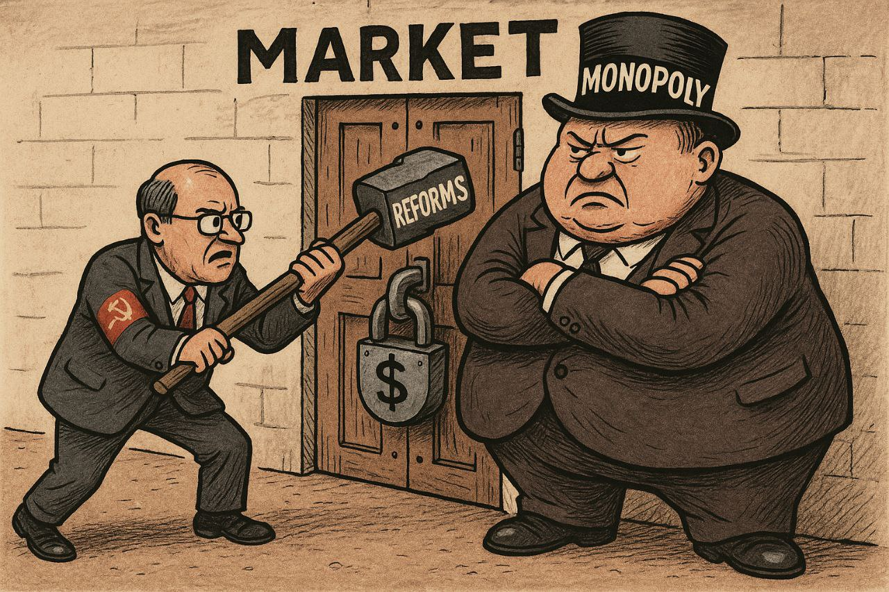

بزرگترین مشکلی که در گذار از سوسیالیسم در اقتصاد‌های سوسیالیستی وجود دارد و اغلب اوقات همین چالش‌ها نه‌تنها گذار را متوقف کردند بلکه منجر به نابودی نظام‌های سیاسی عصر خود نیز شدند ((اصلاحات گورباچف در اتحاد جماهیر شوروی))، بحث مبارزه با انحصار است!

مبارزه با انحصار در وهله اول چندان چالش بزرگی به نظر نمی‌رسد. اما وقتی این موضوع را لحاظ کنیم که این انحصار برای مدتی طولانی وجود داشته است و در نتیجه بازار سیاه خود را با آن سازگار کرده است، قضیه فرق می‌کند.

بنگاه‌های اقتصادی زیرزمینی که از وجود این انحصار سود کلان می‌کنند، هنگام اصلاحات در صف اول مبارزه برای حفظ وضع موجود می‌ایستند.

پس چالش پیش رو دولت‌ها برای گذار از سوسیالیسم فقط پیچیدگی‌های ناشی از حذف قیمت‌گذاری‌های دولتی نیست! چه بسا بتوان گفت چالش اصلی در گذار از سوسیالیسم مبارزه با انحصار و رانت‌های ایجاد شده است!

[\#اقتصاد\_سیاسی](</?tag=اقتصاد سیاسی>)\
[@said\_to\_who\_reads](<https://t.me/said_to_who_reads>)
